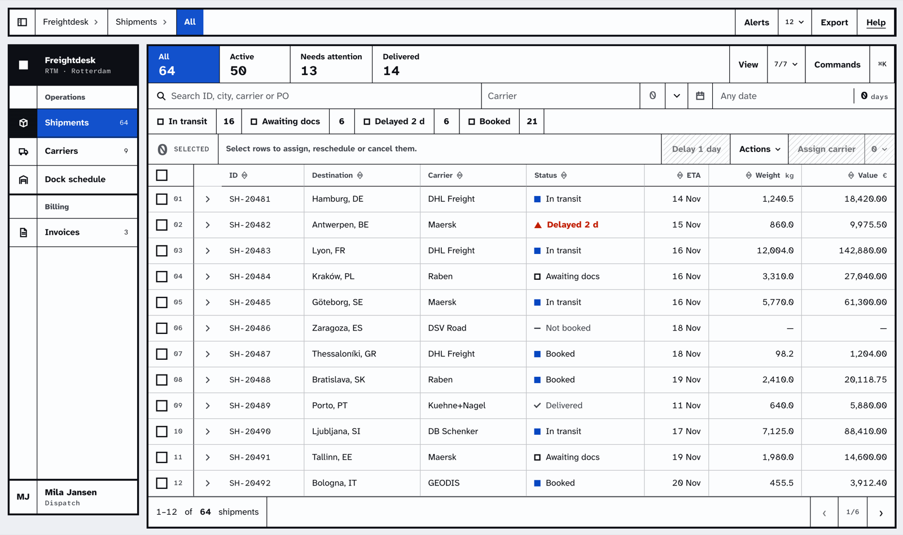

<div align="center">


# Keyline

**React components for dense, precise interfaces.**<br>
Built on [Base UI](https://base-ui.com), installed with the [shadcn CLI](https://ui.shadcn.com/docs/cli), owned by you.

[](LICENSE)
[](#status)
[](https://react.dev)
[](https://tailwindcss.com)
[](https://ui.shadcn.com/docs/registry)

[Documentation](https://keyline-ui.dev) · [Installation](https://keyline-ui.dev/docs/installation) · [Components](#components) · [Contributing](.github/CONTRIBUTING.md)

</div>

<br>

<picture>
  <source media="(prefers-color-scheme: dark)" srcset=".github/assets/keyline-dark.png">
  
</picture>

<p align="center"><sub>A records workflow built only from Keyline components: app shell, nav, tabs, fields, toolbar and table.</sub></p>

## Why Keyline

The look comes from instrument panels. A component is one frame divided into cells, neighbouring cells share a
single keyline, and every state change happens inside a cell.

- **66 components** for work-heavy screens: controls, overlays, tables, navigation, an app shell, charts and chat.
- **Your code.** Like any shadcn registry, Keyline copies each component's source into your project, so it is
  yours to read and change. There is no runtime package to keep up with.
- **Accessible foundations.** Interactive parts are built on Base UI primitives, which handle keyboard, focus and
  ARIA; Keyline's browser tests check them in Chrome, Firefox and WebKit.
- **Lives beside shadcn.** Components install under `components/keyline/`, next to shadcn's `components/ui/`, and
  their styles only touch Keyline's own classes. An opt-in theme brings stock shadcn components into the same
  look when you want it.
- **One theme, tuned in a playground.** Palette, type, density and the cut are tokens; the playground exports
  your configuration as a registry item.
- **Next.js and Vite.** Works in the App Router (server pages included) and in Vite.

## Quick start

In a React 19 + Tailwind CSS 4 app set up for shadcn (`npx shadcn@latest init` creates one), map the Keyline
registry once, then add components by name:

```sh
npx shadcn@latest registry add @keyline-ui=https://keyline-ui.dev/r/{name}.json
npx shadcn@latest add @keyline-ui/button
```

```tsx
import { Button } from "@/components/keyline/ui/button"

export function Save() {
  return <Button variant="primary">Save</Button>
}
```

Each component arrives with the Keyline components, packages and fonts it needs. It is styled with Tailwind
utilities in its source and adds no CSS of its own; the theme's CSS (the `--kl-*` tokens and the shared
construction rules) is merged into the stylesheet named in your `components.json`. Those rules only style
Keyline's names, so your existing components, tokens and `body` look the same.

The [installation guide](https://keyline-ui.dev/docs/installation) (also in [docs/usage.md](docs/usage.md#install))
covers new and existing projects, requirements, updating and removing.

## Components

| Group | Components |
| --- | --- |
| **Actions** | Button, Button group, Split button, Toggle, Toggle group, Toolbar, Menu, Menubar, Context menu |
| **Inputs** | Field and form, Checkbox, Checkbox group, Radio group, Switch, Slider, Segmented, Select, Native select, Combobox, Multiselect, Number field, OTP field, Time field, Date picker and calendar, Date range |
| **Data** | Table, Chart, Stat and meter, Status and badge, Progress, Skeleton, Empty, Avatar, Kbd, Marker |
| **Navigation** | Tabs, Breadcrumb, Pagination, Nav, Navigation menu, Command menu |
| **Overlays** | Dialog, Alert dialog, Drawer, Sheet, Popover, Hover card, Tooltip, Toast, Notice |
| **Layout** | App shell, Sidebar, Panel, Resizable, Scroll area, Accordion, Collapsible, Carousel, Inspector, Item, Direction |
| **Conversation** | Message, Bubble, Message scroller, Attachment, Questionnaire |

Plus the shared theme (`@keyline-ui/keyline`), the opt-in shadcn theme (`@keyline-ui/keyline-shadcn`) and a shipments
demo block. Each component has a page with examples and props on [keyline-ui.dev](https://keyline-ui.dev).

## Requirements

- React 19 and Tailwind CSS 4, in a project the shadcn CLI can install into (one with a `components.json`).
- Next.js App Router, Vite, or another framework the shadcn CLI supports.

## Status

Keyline is pre-release (0.0.0): APIs may still change between versions. Installed source is yours, so an update
reaches your project only when you add a component again with `--overwrite`.

## Develop Keyline

Node.js 24 (see `.nvmrc`) and pnpm (the version is pinned in `package.json`; `corepack enable` provides it):

```sh
pnpm install
pnpm dev             # demo app on :5291: every component, the playground (#/playground), a records workflow (#/app)
pnpm site:dev        # documentation site on :5293: examples, install commands and props for each component
pnpm check           # types, lint, format, unit and browser tests, the registry build
```

```text
src/registry/   the components as they ship, each with a <name>.meta.ts describing its item
src/demo/       the demo app the browser tests run against
src/lib/        cn(), standing in for a consumer's shadcn setup
site/           the documentation site; site/public/r/ is the built registry it serves
tests/          unit tests, browser specs and fresh-project install checks
docs/           usage, design rules and the release procedure
```

[CONTRIBUTING.md](.github/CONTRIBUTING.md) explains how the repository fits together and how to check a change;
[docs/releasing.md](docs/releasing.md) is how a version is published.

## Documentation

- [keyline-ui.dev](https://keyline-ui.dev): installation and one page per component.
- [docs/usage.md](docs/usage.md): installing, configuring, modes, colour roles, composition rules, known limits.
- [docs/design.md](docs/design.md): the design model, and the rules a new component follows.

## Contributing

See [CONTRIBUTING.md](.github/CONTRIBUTING.md). Report security issues privately, as described in
[SECURITY.md](.github/SECURITY.md).

## License

[MIT](LICENSE). Components you install from the registry are yours to change and ship under your own terms; keep
the MIT notice with substantial copies of the source. Keyline contains no vendored third-party code: Base UI, the
libraries it wraps and the Atkinson Hyperlegible and IBM Plex fonts (SIL Open Font License) are installed as npm packages and
carry their own licenses.

The documentation examples borrow character names from *The Office* for fun. Keyline is not affiliated with the
show or its owners, and the portraits are original drawings.
